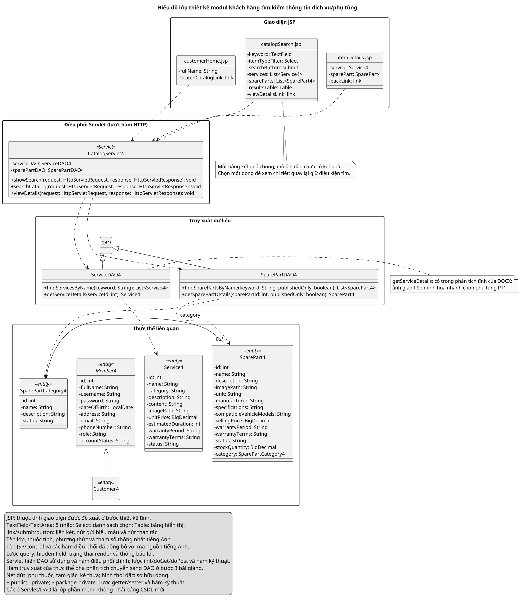

```plantuml
@startuml purchase-design
top to bottom direction
skinparam monochrome true
skinparam shadowing false
skinparam classAttributeIconSize 0
skinparam packageStyle rectangle
skinparam defaultFontName "Times New Roman"
skinparam defaultFontSize 13
skinparam nodesep 25
skinparam ranksep 40
skinparam dpi 160
scale max 6000 width
hide circle
title Biểu đồ lớp thiết kế modul nhân viên kho nhập phụ tùng

package "Giao diện JSP" as UI_LAYER {
class "warehouseHome.jsp" as WarehouseHomeView {
  - fullName: String
  - startPurchaseLink: link
}

class "selectSupplier.jsp" as SelectSupplierView {
  - keyword: TextField
  - searchButton: submit
  - suppliers: List<Supplier4>
  - suppliersTable: Table
  - selectSupplierButton: submit
  - addSupplierLink: link
}

class "newSupplier.jsp" as NewSupplierView {
  - supplier: Supplier4
  - name: TextField
  - address: TextField
  - phoneNumber: TextField
  - email: TextField
  - saveButton: submit
  - backLink: link
}

class "purchaseInvoice.jsp" as PurchaseInvoiceView {
  - purchaseInvoice: PurchaseInvoice4
  - supplier: Supplier4
  - warehouseStaff: WarehouseStaff4
  - keyword: TextField
  - searchButton: submit
  - spareParts: List<SparePart4>
  - sparePartsTable: Table
  - selectSparePartButton: submit
  - invoiceDetailsTable: Table
  - addSparePartButton: submit
  - updateButton: submit
  - confirmButton: submit
  - cancelButton: submit
}

class "newSparePart.jsp" as NewSparePartView {
  - sparePart: SparePart4
  - name: TextField
  - categories: List<SparePartCategory4>
  - category: Select
  - unit: Select
  - manufacturer: TextField
  - description: TextArea
  - specifications: TextField
  - compatibleVehicleModels: TextField
  - imagePath: Select
  - sellingPrice: TextField
  - warrantyPeriod: TextField
  - warrantyTerms: TextArea
  - status: Select
  - saveButton: submit
  - backLink: link
}

class "confirmedInvoice.jsp" as ConfirmedInvoiceView {
  - purchaseInvoice: PurchaseInvoice4
  - invoiceDetailsTable: Table
  - amountPaid: TextField
  - markAsPaidButton: submit
  - printInvoiceLink: link
}

class "printInvoice.jsp" as PrintInvoiceView {
  - purchaseInvoice: PurchaseInvoice4
  - invoiceDetailsTable: Table
  - printButton: button
  - backLink: link
}
}
package "Điều phối Servlet (lược hàm HTTP)" as CONTROL_LAYER {


class SupplierServlet4 <<Servlet>> {
  - supplierDAO: SupplierDAO4
  + showSupplierSelection(request: HttpServletRequest, response: HttpServletResponse): void
  + searchSuppliers(request: HttpServletRequest, response: HttpServletResponse): void
  + showNewSupplier(request: HttpServletRequest, response: HttpServletResponse): void
  + addSupplier(request: HttpServletRequest, response: HttpServletResponse): void
}

class SparePartServlet4 <<Servlet>> {
  - categoryDAO: SparePartCategoryDAO4
  - sparePartDAO: SparePartDAO4
  + showNewSparePart(request: HttpServletRequest, response: HttpServletResponse): void
  + addSparePart(request: HttpServletRequest, response: HttpServletResponse): void
}

class PurchaseInvoiceServlet4 <<Servlet>> {
  - purchaseInvoiceDAO: PurchaseInvoiceDAO4
  - sparePartDAO: SparePartDAO4
  - supplierDAO: SupplierDAO4
  - warehouseStaffDAO: WarehouseStaffDAO4
  + startPurchase(request: HttpServletRequest, response: HttpServletResponse): void
  + showDraft(request: HttpServletRequest, response: HttpServletResponse): void
  + searchSpareParts(request: HttpServletRequest, response: HttpServletResponse): void
  + addInvoiceLine(request: HttpServletRequest, response: HttpServletResponse): void
  + updateInvoiceLines(request: HttpServletRequest, response: HttpServletResponse): void
  + removeInvoiceLine(request: HttpServletRequest, response: HttpServletResponse): void
  + cancelDraft(request: HttpServletRequest, response: HttpServletResponse): void
  + confirmInvoice(request: HttpServletRequest, response: HttpServletResponse): void
  + viewInvoice(request: HttpServletRequest, response: HttpServletResponse): void
  + printInvoice(request: HttpServletRequest, response: HttpServletResponse): void
  + recordPayment(request: HttpServletRequest, response: HttpServletResponse): void
  + showUnpaidInvoices(request: HttpServletRequest, response: HttpServletResponse): void
}




}
package "Truy xuất dữ liệu" as DAO_LAYER {
abstract class DAO {

}

class SupplierDAO4 {
  + findSuppliersByName(keyword: String): List<Supplier4>
  + getSupplierDetails(supplierId: int): Supplier4
  + addSupplier(supplier: Supplier4): int
}

class WarehouseStaffDAO4 {
  + getWarehouseStaffDetails(warehouseStaffId: int): WarehouseStaff4
}

class SparePartCategoryDAO4 {
  + getActiveCategories(): List<SparePartCategory4>
}

class SparePartDAO4 {
  + findSparePartsByName(keyword: String, publishedOnly: boolean): List<SparePart4>
  + getSparePartDetails(sparePartId: int, publishedOnly: boolean): SparePart4
  + addSparePart(sparePart: SparePart4): int
  ~ increaseStockAfterPurchase(connection: Connection, sparePartId: int, quantity: BigDecimal): void
}

class PurchaseInvoiceDAO4 {
  + savePurchaseInvoice(purchaseInvoice: PurchaseInvoice4): int
  + getPurchaseInvoiceDetails(invoiceId: int): PurchaseInvoice4
  + recordPayment(invoiceId: int, amountPaid: BigDecimal, currentWarehouseStaffId: int): boolean
}
}
package "Thực thể liên quan" as ENTITY_LAYER {
abstract class Member4 <<entity>> {
  - id: int
  - fullName: String
  - username: String
  - password: String
  - dateOfBirth: LocalDate
  - address: String
  - email: String
  - phoneNumber: String
  - role: String
  - accountStatus: String
}

abstract class Employee4 <<entity>> {
  - position: String
  - employmentStatus: String
}

class WarehouseStaff4 <<entity>> {

}

class Supplier4 <<entity>> {
  - id: int
  - name: String
  - address: String
  - phoneNumber: String
  - email: String
  - status: String
}

class SparePartCategory4 <<entity>> {
  - id: int
  - name: String
  - description: String
  - status: String
}

class SparePart4 <<entity>> {
  - id: int
  - name: String
  - description: String
  - imagePath: String
  - unit: String
  - manufacturer: String
  - specifications: String
  - compatibleVehicleModels: String
  - sellingPrice: BigDecimal
  - warrantyPeriod: String
  - warrantyTerms: String
  - status: String
  - stockQuantity: BigDecimal
  - category: SparePartCategory4
}

class PurchaseInvoice4 <<entity>> {
  - id: int
  - requestCode: String
  - purchaseDate: LocalDateTime
  - confirmedAt: LocalDateTime
  - paymentStatus: String
  - paidAt: LocalDateTime
  - supplier: Supplier4
  - warehouseStaff: WarehouseStaff4
  - invoiceDetails: List<PurchaseInvoiceDetail4>
  - supplierNameSnapshot: String
  - warehouseStaffNameSnapshot: String
  + calculateTotalAmount(): BigDecimal
}

class PurchaseInvoiceDetail4 <<entity>> {
  - id: int
  - quantity: BigDecimal
  - purchaseUnitPrice: BigDecimal
  - sparePartNameSnapshot: String
  - unitSnapshot: String
  - sparePart: SparePart4
}
}

' Kế thừa Entity
Member4 <|-- Employee4
Employee4 <|-- WarehouseStaff4

' Quan hệ giữa các Entity
PurchaseInvoice4 "0..*" --> "1" Supplier4 : supplier
PurchaseInvoice4 "0..*" --> "1" WarehouseStaff4 : warehouseStaff
PurchaseInvoice4 "1" *-- "0..*" PurchaseInvoiceDetail4 : invoiceDetails
PurchaseInvoiceDetail4 "0..*" --> "1" SparePart4 : sparePart
SparePart4 "0..*" --> "1" SparePartCategory4 : category

' Kế thừa DAO
DAO <|-- WarehouseStaffDAO4
DAO <|-- SupplierDAO4
DAO <|-- PurchaseInvoiceDAO4
DAO <|-- SparePartDAO4
DAO <|-- SparePartCategoryDAO4

' Giao diện phụ thuộc Servlet
WarehouseHomeView ..> SupplierServlet4
SelectSupplierView ..> SupplierServlet4
NewSupplierView ..> SupplierServlet4
SelectSupplierView ..> PurchaseInvoiceServlet4
PurchaseInvoiceView ..> PurchaseInvoiceServlet4
ConfirmedInvoiceView ..> PurchaseInvoiceServlet4
PrintInvoiceView ..> PurchaseInvoiceServlet4
NewSparePartView ..> SparePartServlet4
NewSparePartView ..> PurchaseInvoiceServlet4

' Servlet phụ thuộc DAO
SupplierServlet4 ..> SupplierDAO4
PurchaseInvoiceServlet4 ..> WarehouseStaffDAO4
PurchaseInvoiceServlet4 ..> SupplierDAO4
PurchaseInvoiceServlet4 ..> PurchaseInvoiceDAO4
PurchaseInvoiceServlet4 ..> SparePartDAO4
SparePartServlet4 ..> SparePartDAO4
SparePartServlet4 ..> SparePartCategoryDAO4

' DAO phụ thuộc Entity & DAO nội bộ
WarehouseStaffDAO4 ..> WarehouseStaff4
SupplierDAO4 ..> Supplier4
PurchaseInvoiceDAO4 ..> PurchaseInvoice4
PurchaseInvoiceDAO4 ..> PurchaseInvoiceDetail4
PurchaseInvoiceDAO4 ..> SparePartDAO4 : <<use>>
SparePartDAO4 ..> SparePart4
SparePartCategoryDAO4 ..> SparePartCategory4

' Ghi chú giải thích
note bottom of PurchaseInvoice4
  Nháp: 0..* dòng; đã xác nhận: phải có ít nhất 1 dòng hợp lệ.
  totalAmount là giá trị tính qua getter, không lưu cột SQL.
  Tên áp dụng được chốt từ DB khi xác nhận.
end note

note bottom of PurchaseInvoiceDAO4
  savePurchaseInvoice quản lí transaction: header, toàn bộ dòng, tăng tồn.
  increaseStockAfterPurchase nhận cùng Connection; không tự commit/đóng.
  In/ghi nhận trả tiền không làm tăng tồn thêm.
end note

note bottom of SupplierDAO4
  addSupplier: nhánh 4a trong kịch bản DOCX.
end note

note bottom of SparePartCategoryDAO4
  getActiveCategories và addSparePart ở SparePartDAO4:
  nhánh 8a trong kịch bản DOCX, không phải luồng chính trong ảnh.
end note

' Căn chỉnh thứ tự ngang tự nhiên cho từng tầng
WarehouseHomeView -[hidden]right-> SelectSupplierView
SelectSupplierView -[hidden]right-> NewSupplierView
NewSupplierView -[hidden]right-> PurchaseInvoiceView
PurchaseInvoiceView -[hidden]right-> ConfirmedInvoiceView
ConfirmedInvoiceView -[hidden]right-> PrintInvoiceView
PrintInvoiceView -[hidden]right-> NewSparePartView

SupplierServlet4 -[hidden]right-> PurchaseInvoiceServlet4
PurchaseInvoiceServlet4 -[hidden]right-> SparePartServlet4

WarehouseStaffDAO4 -[hidden]right-> SupplierDAO4
SupplierDAO4 -[hidden]right-> PurchaseInvoiceDAO4
PurchaseInvoiceDAO4 -[hidden]right-> SparePartDAO4
SparePartDAO4 -[hidden]right-> SparePartCategoryDAO4

WarehouseStaff4 -[hidden]right-> Supplier4
Supplier4 -[hidden]right-> PurchaseInvoice4
PurchaseInvoice4 -[hidden]right-> PurchaseInvoiceDetail4
PurchaseInvoiceDetail4 -[hidden]right-> SparePart4
SparePart4 -[hidden]right-> SparePartCategory4

' Căn chỉnh dòng chảy giữa các tầng
WarehouseHomeView -[hidden]down-> SupplierServlet4
SupplierServlet4 -[hidden]down-> DAO
DAO -[hidden]down-> PurchaseInvoiceDAO4
PurchaseInvoiceDAO4 -[hidden]down-> PurchaseInvoice4

legend left
  JSP: thuộc tính giao diện được đề xuất ở bước thiết kế tĩnh.
  TextField/TextArea: ô nhập; Select: danh sách chọn; Table: bảng hiển thị.
  link/submit/button: liên kết, nút gửi biểu mẫu và nút thao tác.
  Tên lớp, thuộc tính, phương thức và tham số thống nhất tiếng Anh.
  Tên JSP/control và các hàm điều phối đã đồng bộ với mã nguồn tiếng Anh.
  Lược query, hidden field, trạng thái render và thông báo lỗi.
  Servlet hiện DAO sử dụng và hàm điều phối chính; lược init/doGet/doPost và hàm kỹ thuật.
  Hàm truy xuất của thực thể pha phân tích chuyển sang DAO ở bước 3 bài giảng.
  calculateTotalAmount vẫn thuộc PurchaseInvoice4; không đưa phép tính sang DAO.
  Nét đứt: phụ thuộc; tam giác: kế thừa; hình thoi đặc: sở hữu dòng.
  + public; - private; ~ package-private. Lược getter/setter và hàm kỹ thuật.
  Các ô Servlet/DAO là lớp phần mềm, không phải bảng CSDL mới.
endlegend
@enduml
```

# Mã PlantUML — hai biểu đồ lớp thiết kế cho mục 4.3.1

**Bố cục hình nhập phụ tùng đã chỉnh:** [SVG](diagrams/purchase-design.svg) và [PNG](diagrams/purchase-design.png) dùng cổng/làn riêng để đường nối không trùng đoạn. Nội dung UML giữ nguyên; để xuất lại đúng bố cục này, dùng [script và hướng dẫn](diagrams/PURCHASE_LAYOUT.md), thay vì bộ tự dàn trang mặc định của PlantUML.

**Bản dùng tên tiếng Anh thống nhất, chốt ngày 21/10/2026.** Đây là bộ tên thiết kế mới để vẽ trước; code, DOCX và VPP gốc chưa đổi tên. Bảng đầy đủ theo từng lớp và chữ ký: [DANH_SACH_DOI_TEN_TIENG_ANH.md](DANH_SACH_DOI_TEN_TIENG_ANH.md); bản lọc Excel: [TEN_CU_TEN_MOI.csv](TEN_CU_TEN_MOI.csv). Giữ ký pháp control theo bài giảng, kiểu dữ liệu và các quan hệ đã chốt.

## 1. Modul khách hàng tìm kiếm thông tin dịch vụ/phụ tùng

Chú thích hình: **Biểu đồ lớp thiết kế modul khách hàng tìm kiếm thông tin dịch vụ/phụ tùng** (đánh số theo vị trí trong báo cáo).

[Mã .puml](diagrams/catalog-design.puml) · [SVG](diagrams/catalog-design.svg) · [PNG](diagrams/catalog-design.png)

Sao chép trọn khối sau, từ `@startuml` tới `@enduml`:

## 2. Modul nhân viên kho nhập phụ tùng

Chú thích hình: **Biểu đồ lớp thiết kế modul nhân viên kho nhập phụ tùng** (đánh số theo vị trí trong báo cáo).

[Mã .puml](diagrams/purchase-design.puml) · [SVG](diagrams/purchase-design.svg) · [PNG](diagrams/purchase-design.png)

Sao chép trọn khối sau, từ `@startuml` tới `@enduml`:

