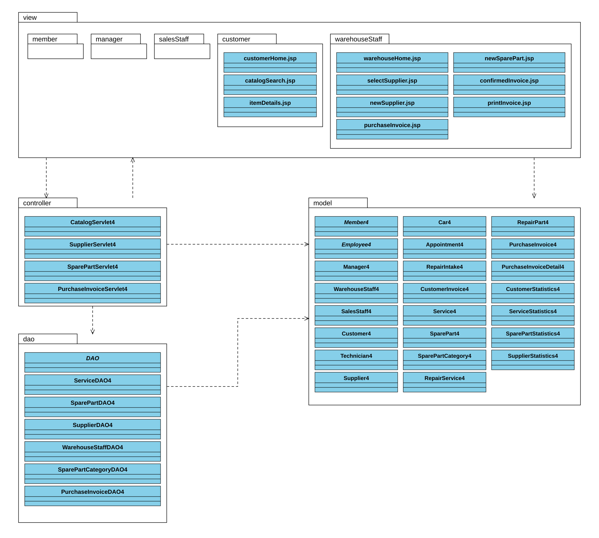

# 2.3.3 Thiết kế triển khai

Quy trình tiến hành các bước như sau:

- Bước 1: Vẽ biểu đồ triển khai của hệ thống: Các máy sẽ cài đặt hệ thống. Mỗi máy đặt các modul hay package nào. Các modul/package tương tác với nhau thế nào.

Áp dụng cho hệ thống GaraMan, các package được thiết kế theo cấu trúc trong Hình 2.13:

- Các lớp thực thể đặt chung trong gói model.
- Các lớp DAO đặt chung trong gói dao.
- Các lớp Servlet đặt chung trong gói controller.
- Các trang JSP để trong gói view. Gói view được chia nhỏ thành các gói nhỏ hơn tương ứng với các giao diện cho các người dùng khác nhau:
  - Các trang thao tác cho đăng nhập và các chức năng tài khoản dùng chung đặt trong gói member.
  - Các trang cho chức năng liên quan đến nhân viên quản lí đặt trong gói manager.
  - Các trang cho chức năng liên quan đến nhân viên kho đặt trong gói warehouseStaff.
  - Các trang cho chức năng liên quan đến nhân viên bán hàng đặt trong gói salesStaff.
  - Các trang cho chức năng liên quan đến khách hàng đặt trong gói customer.

Gói model gồm các lớp thực thể đã được thiết kế cho toàn hệ thống. Gói dao, controller và các trang JSP trong gói view được trình bày theo thiết kế chi tiết của hai modul tìm kiếm thông tin dịch vụ/phụ tùng và nhập phụ tùng.

Hình 2.13: Biểu đồ thiết kế gói của hệ thống GaraMan.

Các trang JSP gửi yêu cầu đến Servlet. Servlet gọi các lớp DAO để truy xuất dữ liệu, sau đó chuyển dữ liệu cho trang JSP hiển thị. Các lớp DAO sử dụng các lớp thực thể trong gói model để đóng gói dữ liệu. Các trang JSP sử dụng dữ liệu của các lớp thực thể để hiển thị thông tin.

Các gói view, controller, dao và model được đóng gói trong ứng dụng garaman.war và triển khai trên máy chủ GaraMan. Các trang JSP thực thi trên Apache Tomcat; máy khách sử dụng trình duyệt để nhận và hiển thị kết quả. Ứng dụng sử dụng JDBC để kết nối với CSDL MySQL. Vị trí các thành phần trên từng máy được trình bày trong [Hình 2.14](THIET_KE_TRIEN_KHAI.md).

---

Phần phía trên dùng cho báo cáo. Danh sách từng thành phần, cách vẽ trong Visual Paradigm và phạm vi đối chiếu code nằm trong [hướng dẫn vẽ package](VE_PACKAGE_VISUAL_PARADIGM.md).

[PDF biểu đồ gói](diagrams/package-diagram.pdf) · [SVG](diagrams/package-diagram.svg) · [PlantUML](diagrams/package-diagram.puml) · [Các thay đổi code](RUT_GON_CODE_THEO_GOI.md).
