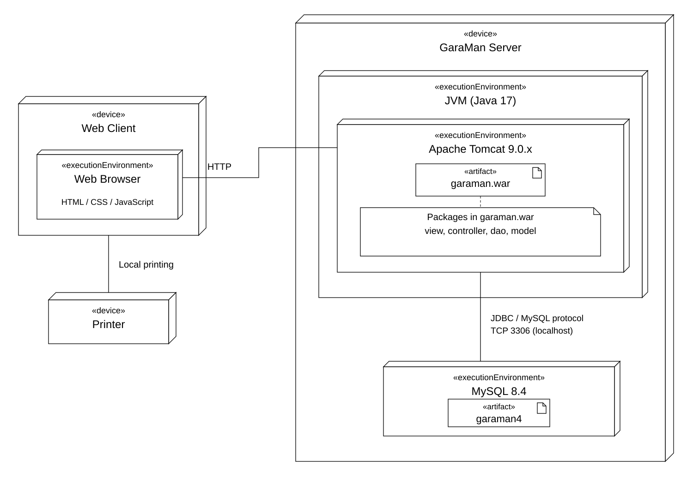

# Biểu đồ triển khai hệ thống GaraMan

Biểu đồ triển khai của hệ thống được trình bày trong Hình 2.14. Hệ thống GaraMan được thiết kế triển khai theo mô hình máy khách – máy chủ:

- Máy khách sử dụng trình duyệt web để truy cập hệ thống. Khách hàng thực hiện chức năng tìm kiếm thông tin dịch vụ/phụ tùng; nhân viên kho thực hiện chức năng nhập phụ tùng theo quyền được cấp.
- Máy in kết nối với máy khách thực hiện in chứng từ hóa đơn nhập.
- Máy chủ GaraMan cài đặt môi trường Java 17 và Apache Tomcat 9.0.x. Ứng dụng được đóng gói thành tệp garaman.war và triển khai trong Apache Tomcat.
- Ứng dụng garaman.war chứa các gói view, controller, dao và model. JSP của gói view thực thi trên Tomcat; trình duyệt nhận HTML, CSS và JavaScript do máy chủ cung cấp.
- Hệ quản trị cơ sở dữ liệu MySQL 8.4 được cài đặt trên cùng máy chủ GaraMan, quản lí cơ sở dữ liệu garaman4.
- Các máy khách giao tiếp với ứng dụng thông qua HTTP. Ứng dụng kết nối với MySQL bằng JDBC qua giao thức MySQL trên TCP, cổng 3306.

Yêu cầu từ máy khách được Servlet điều phối tiếp nhận. Servlet sử dụng các lớp DAO và model để xử lí dữ liệu, sau đó chuyển dữ liệu cho JSP hiển thị. Các quan hệ sử dụng giữa các gói được trình bày trong [biểu đồ gói](THIET_KE_GOI.md); vị trí triển khai được ghi trực tiếp ở chú thích gắn với garaman.war trên hình dưới.

Hình 2.14: Biểu đồ triển khai của hệ thống GaraMan.

---

Hình thể hiện phương án triển khai mục tiêu theo cấu hình mặc định của project. Web Client đại diện cho loại máy khách dùng trình duyệt, có thể có nhiều máy thực tế; không tách loại máy theo từng actor. Máy in được sử dụng tại máy khách thực hiện nghiệp vụ in hóa đơn. Phần này đặt tiếp sau [biểu đồ gói](THIET_KE_GOI.md) trong mục 2.3.3 của báo cáo.

Ký hiệu node, môi trường thực thi, artifact và đường kết nối được đối chiếu với [tài liệu chính thức của Visual Paradigm](https://www.visual-paradigm.com/VPGallery/diagrams/Deployment.html).

[PDF](diagrams/deployment-diagram.pdf) · [PNG](diagrams/deployment-diagram.png) · [Mã PlantUML](diagrams/deployment-diagram.puml) · [Hướng dẫn vẽ và căn cứ nguồn](VE_DEPLOYMENT_VISUAL_PARADIGM.md).
